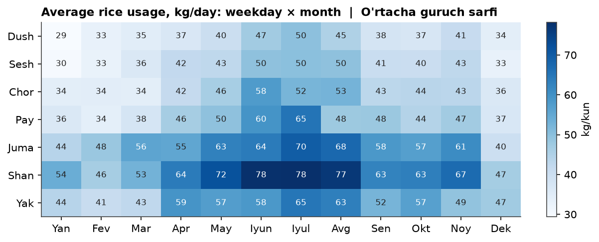
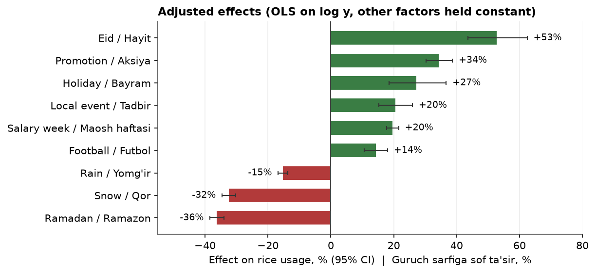
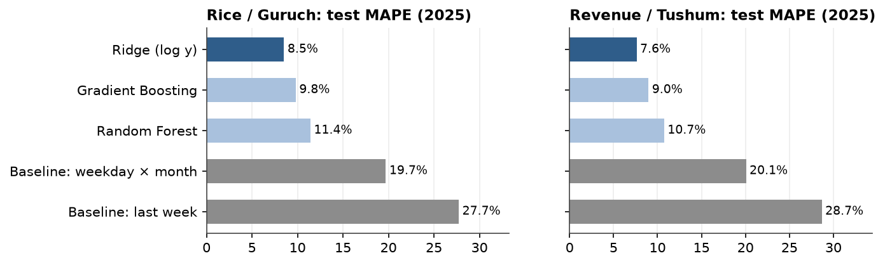
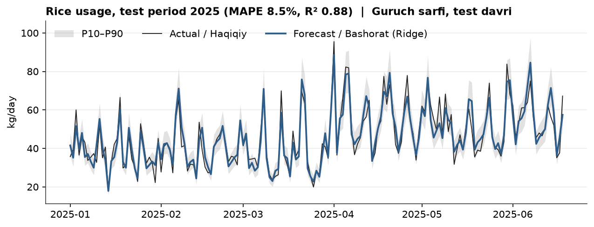

# Restaurant Sales Analysis & Demand Forecasting

**English** · [O'zbekcha](README.uz.md)

Statistical analysis of 900 days of restaurant sales and a model that forecasts **daily rice usage** and **revenue** 1–7 days ahead.

**[▶ Interactive dashboard](https://faxriddinprof.github.io/sales-analysis/)** · Notebooks (interactive charts via nbviewer):
[1. Overview](https://nbviewer.org/github/faxriddinprof/sales-analysis/blob/main/notebooks/01_overview.ipynb) ·
[2. Feature analysis](https://nbviewer.org/github/faxriddinprof/sales-analysis/blob/main/notebooks/02_feature_analysis.ipynb) ·
[3. Modeling](https://nbviewer.org/github/faxriddinprof/sales-analysis/blob/main/notebooks/03_modeling.ipynb)

---

## Data

`data/sales.csv`: one row per day, 2023-01-01 to 2025-06-18 (900 days, 21 columns, no missing values).

| Group | Columns |
|---|---|
| Outcomes | `customers`, `rice_kg` (target), `salad_count`, `revenue_uzs` (target) |
| Weather | `temp_c`, `humidity`, `wind`, `rain`, `snow` |
| Calendar | `weekday`, `is_weekend`, `month`, `season`, `is_holiday`, `ramadan`, `eid`, `salary_week` |
| Events | `promotion`, `local_event`, `football_match` |

## Key findings

**1. Demand is driven by the weekly and yearly cycle.** Saturday ≈ 1.6 × Monday, summer ≈ 1.5 × winter.



**2. Adjusted effects of each factor** (multiple regression on `log y`, other factors held constant):



- Raw differences are misleading. Snow looks like −44% but is −32% once season is controlled for (snowy days fall in low-demand winter). Holidays look insignificant raw (+15%, p = 0.18) but are +27% adjusted.
- Humidity correlates with demand (r ≈ −0.4) only because it tracks temperature (r ≈ −0.79). Its adjusted effect is ≈ 0.
- Rice and revenue respond almost identically: both are ≈ linear in customer count (r ≈ 0.99).

**3. A simple linear model wins.** Test on 2025 (169 days, never used for tuning):



| Model | Rice MAPE | Rice R² | Revenue MAPE | Revenue R² |
|---|---|---|---|---|
| Baseline: same day last week | 27.7% | −0.24 | 28.7% | −0.30 |
| Baseline: weekday × month mean | 19.7% | 0.35 | 20.1% | 0.31 |
| **Ridge (log y)** | **8.5%** | **0.885** | **7.6%** | **0.904** |
| Random Forest | 11.4% | 0.71 | 10.7% | 0.71 |
| Gradient Boosting | 9.8% | 0.80 | 9.0% | 0.82 |

Effects are multiplicative and show no interactions, so on the log scale the problem is additive. A regularised linear model fits that structure exactly. Tree models have to approximate it with many splits from only 731 training days. Random Forest overfits (4% train vs 11% test error).



The P10–P90 band (split-conformal, from walk-forward CV residuals) covers 80–84% of test days (target: 80%).

**4. Roughly half of the remaining error is irreducible.** Even with the true customer count known, rice error stays ≈ 4.5%, because per-customer consumption varies day to day.

## Methodology

| Step | Choice |
|---|---|
| Split | Train 2023–2024 (731 days), test 2025 (169 days), split by time. All feature selection and tuning on train only |
| Validation | Walk-forward CV, 5 folds × 73 days, each fold trained on ≥ 1 year |
| Target | `log(y)`: removes skew (0.83 → −0.16) and makes effects interpretable as % |
| Leakage | `customers` and `salad_count` excluded, since they are only known at end of day |
| Features (27) | temperature, rain, snow, 7 calendar/event flags, weekday and month dummies |
| Removed | `is_weekend` and `season` (perfectly collinear, VIF = ∞), `humidity` and `wind` (no adjusted effect), lags |
| Lags | After controlling for calendar and weather, residuals are white noise (Ljung–Box p > 0.1) and lag features add nothing (F-test p = 0.17). One model therefore serves every horizon from 1 to 7 days |
| Diagnostics | Correlation and covariance matrices, Cramér's V, VIF and condition number, STL, ADF, ACF/PACF, SHAP |

## Project structure

```
data/sales.csv                       source data
notebooks/01_overview.ipynb          stage 1: descriptive statistics, KPIs, per-year charts
notebooks/02_feature_analysis.ipynb  stage 2: correlation, covariance, multicollinearity, adjusted effects
notebooks/03_modeling.ipynb          stage 3: models, evaluation, error analysis, 7-day forecast
src/data.py                          loading, column dictionary, quality checks
src/features.py                      feature engineering (single source for all stages)
src/models.py                        baselines, model grid, metrics, Forecaster
src/style.py                         shared chart style
src/build_dashboard.py               builds docs/index.html from saved figures
src/readme_figures.py                static PNGs for this README
models/forecaster.joblib             final model (trained on all 900 days)
docs/index.html                      dashboard (served by GitHub Pages)
```

## Quickstart

```bash
python3 -m venv .venv
.venv/bin/pip install -r requirements.txt

# re-run the analysis, then rebuild the dashboard and README images
for nb in notebooks/0*.ipynb; do .venv/bin/jupyter nbconvert --to notebook --execute --inplace "$nb"; done
.venv/bin/python -m src.build_dashboard
.venv/bin/python -m src.readme_figures
```

Forecast new days:

```python
import pandas as pd
from src.models import Forecaster

days = pd.DataFrame({"date": ["2025-06-19", "2025-06-20"], "temp_c": [34, 35],
                     "rain": [False, False], "promotion": [False, True]})
Forecaster.load().predict(days)   # rice_kg_P10/P50/P90, revenue_uzs_P10/P50/P90
```

Flags that are not given default to `False`. `weekday`, `month` and `salary_week` are derived from the date.

## Limitations

- Weather columns are observations, not forecasts. Real-world error will be somewhat higher.
- The test period covers only winter and spring. Summer and autumn accuracy is estimated by CV only.
- In 2025 Saturdays were over-forecast by ≈ 7%, and snowy days by ≈ 10%. The model should be retrained regularly.
- Rare events (Eid: 6 days, holidays: 18 days) have wide confidence intervals.
