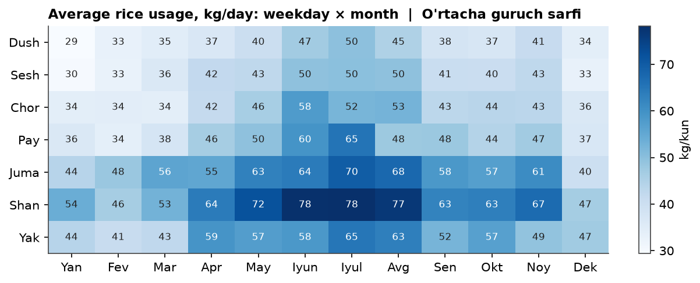
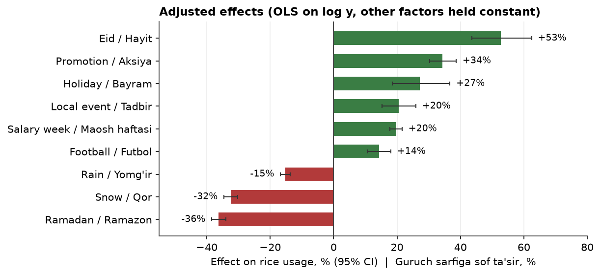
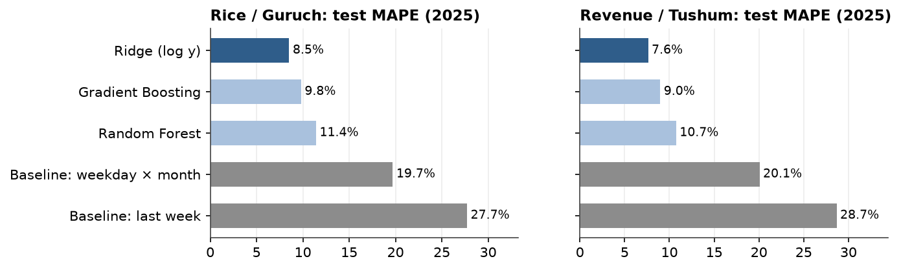
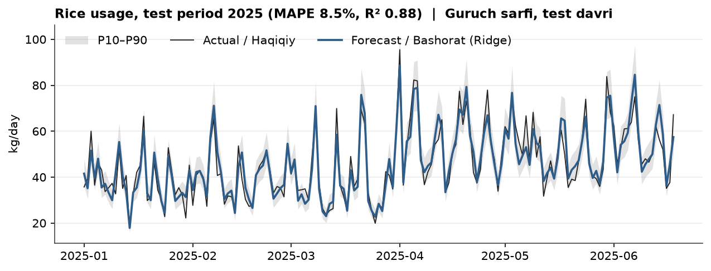

# Oshxona savdosi tahlili va talab bashorati

[English](README.md) · **O'zbekcha**

Oshxonaning 900 kunlik savdo ma'lumotlarining statistik tahlili hamda **kunlik guruch sarfi** va **tushumni** 1–7 kun oldinga bashorat qiluvchi model.

**[▶ Interaktiv dashboard](https://faxriddinprof.github.io/sales-analysis/)** · Notebooklar (interaktiv grafiklar nbviewer orqali):
[1. Umumiy tahlil](https://nbviewer.org/github/faxriddinprof/sales-analysis/blob/main/notebooks/01_overview.ipynb) ·
[2. Featurelar tahlili](https://nbviewer.org/github/faxriddinprof/sales-analysis/blob/main/notebooks/02_feature_analysis.ipynb) ·
[3. Modellash](https://nbviewer.org/github/faxriddinprof/sales-analysis/blob/main/notebooks/03_modeling.ipynb)

---

## Ma'lumot

`data/sales.csv`: har bir qator bitta kun, 2023-01-01 dan 2025-06-18 gacha (900 kun, 21 ustun, bo'sh qiymat yo'q).

| Guruh | Ustunlar |
|---|---|
| Natija | `customers`, `rice_kg` (target), `salad_count`, `revenue_uzs` (target) |
| Ob-havo | `temp_c`, `humidity`, `wind`, `rain`, `snow` |
| Kalendar | `weekday`, `is_weekend`, `month`, `season`, `is_holiday`, `ramadan`, `eid`, `salary_week` |
| Tadbirlar | `promotion`, `local_event`, `football_match` |

## Asosiy natijalar

**1. Talabni haftalik va yillik sikl belgilaydi.** Shanba ≈ Dushanba × 1.6, yoz ≈ qish × 1.5.



**2. Har bir omilning sof ta'siri** (`log y` bo'yicha ko'p omilli regressiya, boshqa omillar o'zgarmas):



- Xom farqlar chalg'itadi. Qor −44% ko'rinadi, lekin mavsum hisobga olinsa −32% chiqadi, chunki qorli kunlar talab past bo'lgan qishga to'g'ri keladi. Bayram xom holda ahamiyatsiz (+15%, p = 0.18), sof ta'siri esa +27%.
- Namlik talab bilan korrelyatsiyaga ega (r ≈ −0.4), lekin faqat harorat bilan bog'liq bo'lgani uchun (r ≈ −0.79). Uning sof ta'siri ≈ 0.
- Guruch va tushum deyarli bir xil javob beradi: ikkalasi ham mijozlar soniga deyarli chiziqli bog'liq (r ≈ 0.99).

**3. Oddiy chiziqli model yutdi.** Test 2025-yil ma'lumotida (169 kun, sozlashda umuman ishlatilmagan):



| Model | Guruch MAPE | Guruch R² | Tushum MAPE | Tushum R² |
|---|---|---|---|---|
| Baseline: o'tgan haftaning shu kuni | 27.7% | −0.24 | 28.7% | −0.30 |
| Baseline: hafta kuni × oy o'rtachasi | 19.7% | 0.35 | 20.1% | 0.31 |
| **Ridge (log y)** | **8.5%** | **0.885** | **7.6%** | **0.904** |
| Random Forest | 11.4% | 0.71 | 10.7% | 0.71 |
| Gradient Boosting | 9.8% | 0.80 | 9.0% | 0.82 |

Omillar ta'siri foizli (multiplikativ) va ular orasida interaksiya yo'q. Shuning uchun log shkalada masala qo'shiluvchi bo'ladi va regulyarizatsiyali chiziqli model bu tuzilishga aynan mos keladi. Daraxtli modellar esa uni 731 kunlik train ma'lumotida ko'p bo'linishlar bilan taxminan qurishga majbur. Random Forest overfit qiladi: train'da xato 4%, test'da 11%.



P10–P90 oralig'i (split-conformal usuli, walk-forward CV qoldiqlaridan olingan) test kunlarining 80–84% ini qamraydi. Maqsad 80% edi.

**4. Qolgan xatoning taxminan yarmini kamaytirib bo'lmaydi.** Mijozlar soni aniq ma'lum bo'lsa ham, guruch xatosi ≈ 4.5% qoladi, chunki bir mijozning guruch iste'moli kundan kunga o'zgaradi.

## Metodologiya

| Qadam | Tanlov |
|---|---|
| Bo'linish | Vaqt bo'yicha: train 2023–2024 (731 kun), test 2025 (169 kun). Feature tanlash va sozlash faqat train'da |
| Validatsiya | Walk-forward CV, 5 fold × 73 kun, har bir fold kamida 1 yillik ma'lumotda o'qitiladi |
| Target | `log(y)`: qiyshiqlikni yo'qotadi (0.83 → −0.16), ta'sirlarni % sifatida o'qish imkonini beradi |
| Leakage | `customers` va `salad_count` chiqarilgan, chunki ular faqat kun oxirida ma'lum bo'ladi |
| Featurelar (27) | harorat, yomg'ir, qor, 7 ta kalendar/tadbir belgisi, hafta kuni va oy dummy'lari |
| Olib tashlangan | `is_weekend` va `season` (mukammal kollinear, VIF = ∞), `humidity` va `wind` (sof ta'siri yo'q), lag featurelar |
| Laglar | Kalendar va ob-havo hisobga olingach, qoldiqlar oq shovqin (Ljung–Box p > 0.1), lag featurelar foyda bermaydi (F-test p = 0.17). Shuning uchun 1 kundan 7 kungacha bo'lgan har qanday ufq uchun bitta model ishlaydi |
| Diagnostika | Korrelyatsiya va kovariatsiya matritsalari, Cramér's V, VIF va condition number, STL, ADF, ACF/PACF, SHAP |

## Loyiha tuzilmasi

```
data/sales.csv                       manba ma'lumot
notebooks/01_overview.ipynb          1-bosqich: tavsifiy statistika, KPI, har yil bo'yicha grafiklar
notebooks/02_feature_analysis.ipynb  2-bosqich: korrelyatsiya, kovariatsiya, multikollinearlik, sof ta'sir
notebooks/03_modeling.ipynb          3-bosqich: modellar, baholash, xatolar tahlili, 7 kunlik bashorat
src/data.py                          yuklash, ustunlar lug'ati, sifat tekshiruvlari
src/features.py                      feature engineering (barcha bosqichlar uchun yagona manba)
src/models.py                        baseline'lar, modellar, metrikalar, Forecaster
src/style.py                         grafiklar uchun umumiy uslub
src/build_dashboard.py               saqlangan grafiklardan docs/index.html ni quradi
src/readme_figures.py                README uchun statik PNG rasmlar
models/forecaster.joblib             yakuniy model (900 kunning barchasida o'qitilgan)
docs/index.html                      dashboard (GitHub Pages orqali ochiladi)
```

## Ishga tushirish

```bash
python3 -m venv .venv
.venv/bin/pip install -r requirements.txt

# tahlilni qayta ishga tushirish, keyin dashboard va README rasmlarini qayta qurish
for nb in notebooks/0*.ipynb; do .venv/bin/jupyter nbconvert --to notebook --execute --inplace "$nb"; done
.venv/bin/python -m src.build_dashboard
.venv/bin/python -m src.readme_figures
```

Yangi kunlar uchun bashorat:

```python
import pandas as pd
from src.models import Forecaster

days = pd.DataFrame({"date": ["2025-06-19", "2025-06-20"], "temp_c": [34, 35],
                     "rain": [False, False], "promotion": [False, True]})
Forecaster.load().predict(days)   # rice_kg_P10/P50/P90, revenue_uzs_P10/P50/P90
```

Berilmagan belgilar `False` deb olinadi. `weekday`, `month` va `salary_week` sanadan hisoblanadi.

## Cheklovlar

- Ob-havo ustunlari prognoz emas, haqiqiy kuzatuv. Real ishlatishda xato biroz yuqoriroq bo'ladi.
- Test davri faqat qish va bahorni qamraydi. Yoz va kuz oylaridagi aniqlik faqat CV bilan baholangan.
- 2025-yilda model Shanba kunlarini ≈ 7%, qorli kunlarni ≈ 10% ortiqcha bashorat qildi. Modelni muntazam qayta o'qitish kerak.
- Kam uchraydigan hodisalarning (Hayit: 6 kun, bayram: 18 kun) ishonch oraliqlari keng.
